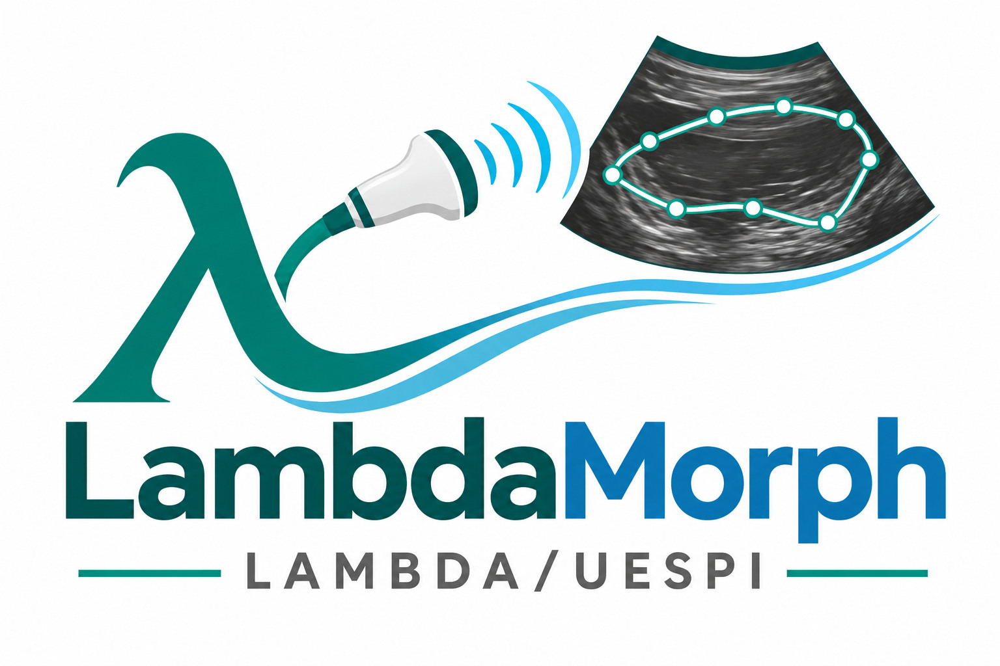

# LambdaMorph



**Scientific ultrasound image analysis for livestock research**

**LambdaMorph** (formerly **EchoMetrics**) is an open-source, browser-based application developed within **LAMBDA at Universidade Estadual do Piauí (UESPI)** for manually annotating B-mode ultrasound images and extracting morphometric measurements in animal science. It supports research workflows involving sheep, cattle, goats, and other livestock.

> **Research status:** Version 2.4 is under development. Automated software tests do not establish anatomical accuracy, repeatability, or agreement with a reference method. Operators should follow a defined acquisition/annotation protocol and validate the software for its intended research use.

## Try the application

| Environment | URL | Status |
| --- | --- | --- |
| Legacy original (`main`) | [EchoMetrics (original)](https://echometrics-m33u.onrender.com/) | Older public deployment; retained during migration |
| Current development (`develop-v2`) | [LambdaMorph 2.4 (development)](https://echometrics-v2-dev.onrender.com/) | Tested development build; URL remains unchanged for now |
| Source code | [LambdaMorph on GitHub](https://github.com/CintiaAraujo-Zoo/LambdaMorph) | MIT licensed |

The free Render service may be slow to respond after inactivity. The old deployment URLs will be reconsidered after confirming the identity migration.

## Features (development 2.4)

- **Interactive ROI tools:** freehand drawing, polygon marking and editable points for the longissimus muscle area (AOL / REA).
- **Flexible calibration:** measure a known image reference length to convert pixels to centimeters.
- **Repeated subcutaneous fat thickness (EGS / BFT):** 1–3 manually positioned lines, individual values, mean and *sample* standard deviation.
- **Muscle perimeter:** derived from the same contour used for the calculated AOL.
- **Optional muscle depth:** a separately annotated two-point distance, subject to a consistent anatomical definition.
- **Review and edit:** reopen the most recent analysis, adjust markings, undo revisions or recalculate.
- **Single-image and batch workflows:** analyze individual images or accumulate batch results.
- **Research metadata:** animal ID, session ID, species, body condition score, original filename and calibration information.
- **Exports:** annotated PNG and Excel workbook (`.xlsx`) including measurements and metadata in batch mode.
- **Appearance and language:** light/dark theme and English/Brazilian Portuguese interface. Some dynamic messages or exported labels may remain in English.

**Supported uploads:** PNG, JPEG, BMP and GIF; up to 20 MB per file. Animated images and unusual encodings require additional quality checks.

## Measurement workflow

1. Import an ultrasound image and supply optional research metadata.
2. Calibrate using two endpoints a known distance apart in the image.
3. Trace the longissimus muscle border using **Freehand** or **Polygon**, then refine it using **Edit points**.
4. Mark one, two or three EGS lines according to the experimental protocol.
5. Optionally mark muscle depth with its own two endpoints.
6. Review the contours and measurements; correct any erroneous markings.
7. Export the annotated image and, for a batch, the Excel workbook.

## Measurement formulas

For a calibration distance of `d_scale_px` pixels representing `L_scale_cm` centimeters:

```text
pixels_per_cm = d_scale_px / L_scale_cm
AOL_cm2       = area_px2 / pixels_per_cm**2
perimeter_cm  = closed_contour_length_px / pixels_per_cm
EGS_i_cm      = two_point_distance_i_px / pixels_per_cm
EGS_mean_cm   = mean(EGS_i_cm)
EGS_sd_cm     = sample_standard_deviation(EGS_i_cm)  # 0 displayed for n=1
muscle_depth_cm = two_point_depth_distance_px / pixels_per_cm  # if marked
```

The AOL and perimeter are calculated from the annotated closed contour. The geometry **does not identify anatomical landmarks automatically**. The EGS summary is descriptive; repeated lines at different anatomical locations are not interchangeable with repeated readings at a single site. Define locations, operators, image orientation and quality-control rules before data collection.

## Run locally

Recommended: Python 3.11.

```bash
git clone https://github.com/CintiaAraujo-Zoo/LambdaMorph.git
cd LambdaMorph
git switch develop-v2
python -m venv .venv
```

Windows PowerShell:

```powershell
.\.venv\Scripts\python.exe -m pip install -r requirements.txt
.\.venv\Scripts\python.exe app.py
```

macOS / Linux:

```bash
./.venv/bin/python -m pip install -r requirements.txt
./.venv/bin/python app.py
```

Open **http://127.0.0.1:5000** in your browser.

## Automated software tests

```powershell
.\.venv\Scripts\python.exe -m unittest discover -s tests -v
```

These tests cover selected backend calculations, exports, input validation, interface wiring and branding. They **do not** replace a repeatability or agreement study against trained experts or reference measurements.

## Data handling and limitations

Uploaded images are processed from temporary server memory; the application does not currently provide durable hosted storage. Local archives of original images, annotated PNGs, calibration details and exported workbooks remain the researcher's responsibility. For sensitive data, verify that uploading to a third-party hosted service is permitted or use the software locally.

See the source code for current validation constraints and output fields. Automatic anatomical segmentation and longitudinal session recovery are not implemented.

## Development and deployment

Development occurs on `develop-v2`; the older `main` branch is currently preserved as a legacy/original version. The `render.yaml` file still contains the old service name for backward compatibility during migration. Actual Render service settings should be checked before changing its deployment name or URL.

### Roadmap

- Persist and resume analysis sessions without relying exclusively on browser memory.
- Save reproducible ROI coordinates and calibration metadata in a portable project format.
- Perform repeatability, observer agreement and reference-method validation.
- Explore assisted segmentation after establishing validated reference annotations.

Roadmap items are proposed work, not released features.

## Citation

For research manuscripts, cite the **exact software version or Git commit** used. Until a formal release and DOI exist, a suggested provisional reference is:

> Araujo, C. M. (2026). *LambdaMorph: Scientific ultrasound image analysis for livestock research* [Computer software]. GitHub. https://github.com/CintiaAraujo-Zoo/LambdaMorph

Also report the scanner/probe, acquisition plane, reference scale, anatomical rules, annotation mode and software commit in the methods section.

## Author, affiliation and license

Developed by **Cintia M. Araujo** within **LAMBDA — Universidade Estadual do Piauí (UESPI)**, Brazil.

Licensed under the [MIT License](LICENSE). Contributions and issues are welcome through the repository.
